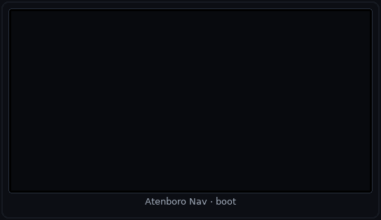
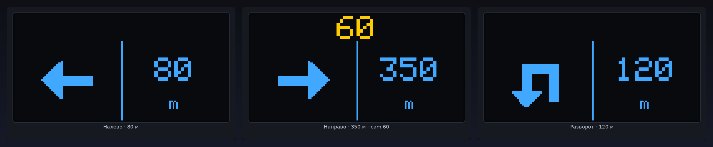
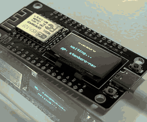
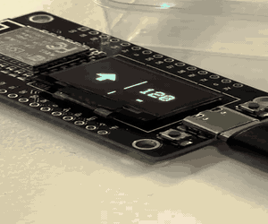

# Atenboro Nav

[](LICENSE)
[](https://github.com/jdmarshall95/atenboro-nav/actions/workflows/ci.yml?query=branch%3Amain)
[](VERSION)

**Навигационный HUD для мотоцикла:** телефон с 2ГИС остаётся в кармане, на руле — дешёвый dual-color OLED (шеврон, дистанция, камера). Связь — Wi‑Fi **SoftAP** на плате **HW-364A** (ESP8266 + SSD1306 128×64). Open source, MIT.

Android-прокси читает манёвры через **Dashboard AIDL API** 2ГИС (запасные каналы — notification / Accessibility) и шлёт кадры на плату по HTTP.

<p align="center">
  
</p>

---

## 🚀 Quick Start

### Симуляция без железа

Mock SoftAP на хосте — LTE/интернет эмулятора не трогаем.

```bash
python3 -m venv .venv && source .venv/bin/activate
pip install -r scripts/requirements.txt

./scripts/mock_board.py              # http://0.0.0.0:18765
adb shell setprop debug.atenboro.esp_url http://10.0.2.2:18765
./scripts/emu_mock_drive.sh          # inject slight / u-turn / дальние дистанции
```

Скриптовый «заезд» (HUD inject / mock GPS):

```bash
./scripts/sim_route_drive.sh hud     # только кадры на OLED-прокси
./scripts/sim_route_drive.sh full    # geo + мониторинг сессии
```

Подробнее: [`docs/TESTING.md`](docs/TESTING.md), [`CONTRIBUTING.md`](CONTRIBUTING.md).

### Запуск на реальном железе

1. **Прошивка** (или скачать `.bin` из [Releases](https://github.com/jdmarshall95/atenboro-nav/releases)):

   ```bash
   pip install -r .github/requirements-ci.txt
   cd firmware && pio run -t upload --upload-port /dev/ttyUSB0
   ```

2. Подключиться к SoftAP платы: `atenboro-nav` / `atenboro1` → `http://192.168.4.1`.

3. Установить APK, в приложении: **Подключить к плате → Accessibility → уведомления → прокси**.

4. Запустить навигацию в 2ГИС (экран можно блокировать).

Распиновка и питание: [`docs/WIRING.md`](docs/WIRING.md).

---

## 🏗 Architecture

```
2ГИС ── AIDL Dashboard API ──► Atenboro (Android) ── SoftAP HTTP ──► ESP8266 OLED
        (запас: notif / a11y)         │
                                     └─ SocketFactory SoftAP (LTE процесса не гасится)
```

| Слой | Роль |
|------|------|
| **2ГИС** | Источник манёвра: `maneuverIcon`, дистанция, камера (AIDL); fallback — ongoing-notification / a11y |
| **Android** (`android/`) | FGS-прокси: приоритет AIDL → notif → a11y; dual-path SoftAP + LTE; `POST /nav` |
| **Firmware** (`firmware/`) | SoftAP `192.168.4.1`, HTTP API, PROGMEM-глифы по PDF-кодоименам 2ГИС, dual-color SSD1306 |

Пока AIDL свежий (~10 с), notif/a11y **не** перебивают `turn` на OLED. Неизвестный `maneuver_icon` → fallback на coarse `turn`.

---

## OLED HUD

| Полоса | Цвет | Содержание |
|--------|------|------------|
| сверху (`y0–15`) | жёлтый | камера: мигание + лимит км/ч |
| снизу слева | синий | шеврон манёвра (в т.ч. slight / u-turn) |
| снизу справа | синий | дистанция: метры → `3.8 km` → целые км |

<p align="center">
  
</p>

<p align="center">
  
  &nbsp;
  
</p>

---

## Документация

| Документ | Содержание |
|----------|------------|
| [`docs/WIRING.md`](docs/WIRING.md) | Пины, OLED, питание |
| [`docs/TESTING.md`](docs/TESTING.md) | Чеклист, locked-screen, mock |
| [`CONTRIBUTING.md`](CONTRIBUTING.md) | venv, pre-commit, симуляция, сборка |
| [`CHANGELOG.md`](CHANGELOG.md) | История версий |

---

## API платы

| Метод | Путь | Описание |
|-------|------|----------|
| `GET` | `/health` | версия |
| `POST` | `/nav` | `turn`, `maneuver_icon`, `dist_m`, `camera`, `cam_*`, … |
| `GET` | `/screen` | framebuffer + meta |
| `*` | `/debug` | лог телефон ↔ плата |

```bash
curl -s -X POST http://192.168.4.1/nav \
  -H 'Content-Type: application/json' \
  -d '{"turn":"left","dist_m":80,"camera":true,"cam_kmh":60}'
```

---

## Репозиторий

| Путь | Назначение |
|------|------------|
| [`firmware/`](firmware/) | SoftAP + OLED (PlatformIO) |
| [`android/`](android/) | прокси 2ГИС |
| [`scripts/`](scripts/) | mock, симуляция, генерация глифов |
| [`docs/screens/`](docs/screens/) | скриншоты OLED и UI |

---

## Roadmap

| Сейчас | Дальше |
|--------|--------|
| HW-364A, ESP8266 SoftAP | **ESP32‑C3** + **BLE GATT** (наушники параллельно) |
| Li‑ion ~650 mAh | 1000–2000 mAh + TP4056 |

---

## License

[MIT](LICENSE)
